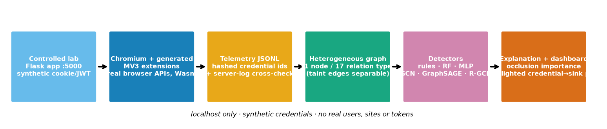

# AuthGraph: Authentication-Aware Graph Learning for Unauthorized Credential Data Flows in Browser Extensions

*Prototype report. Every number below is copied from an executed run (`results/tables.md`, `experiments.csv`). Anything not run is marked NOT YET MEASURED. Figures are in `figures/`.*

## 1. Abstract
We build a controlled local laboratory in which real Chromium (Playwright build) loads generated Manifest-V3 extensions that read **synthetic** cookies/JWTs and send data to approved or unapproved localhost destinations, optionally through JavaScript hops, WebAssembly, the service worker and extension storage. Runtime telemetry (576 sessions, 144 extensions, 12 scenario families, 7,258 events) is converted into authentication-aware heterogeneous graphs and classified by rules, Random Forest, MLP, GCN, GraphSAGE and R-GCN, with extension-level splits, leave-one-family-out "unseen flow" tests and ablations. **Main finding (measured, on this synthetic dataset):** graph-based GraphSAGE generalises to never-seen Wasm-involving flows (recall 0.929 ± 0.050) where a taint rule (0.646) and count-based flat models (0.617–0.688) do not; **our proposed R-GCN underperformed** (recall 0.450 ± 0.109), i.e. the relation-typed model was not the winning architecture in this setting.

## 2. Introduction
Browser extensions legitimately read cookies and page data, so the security question is whether *authentication-sensitive* data reaches a destination it should not. We study whether a graph of observed extension behaviour helps detect such flows, especially when part of the flow (WebAssembly) is opaque to JavaScript-level taint tracking.

## 3. Problem statement
Given the runtime telemetry of one extension session, decide whether credential-derived data was sent to an unapproved destination, and explain which path led to the decision.

## 4. Threat model (lab only)
Controlled proof-of-concept behaviours: an extension with `cookies`, `storage` and localhost host permissions reads a synthetic session cookie/JWT and sends it (possibly transformed) to a localhost host that is not on the approved list. No real credentials, sites, users, persistence or external network are involved. "Approved" destinations are a policy list (`api.lab.localhost`, `cdn.lab.localhost`). Ground-truth label = scenario design (credential-derived data → unapproved destination).

## 5. Related work (verified by search; read full texts before formal citation)
* **DoubleX** (Fass et al., ACM CCS 2021) — static Extension Dependence Graph for vulnerable data flows; evaluated on 154,484 Chrome extensions.
* **Arcanum** (Xie, Kasi Murali, Pearce, Li, USENIX Security 2024) — dynamic taint tracking of user content from web pages to network sinks in modern Chrome extensions.
* **Spying extensions** (arXiv:1612.00766, "I Spy with My Little Eye") and other ML detectors using API/activity features.
* **Behaviour-graph / heterogeneous-graph GNN malware detection** exists in general (e.g. MalSage — *title seen in search snippet only; venue not verified*).
* **Wasm–JS extension attacks**: "The Blind Spot of Extension Security: WebAssembly–JavaScript Collaborative Attacks on Chrome" (Electronics, DOI 10.3390/electronics15143049 — *found via search snippet; not read*).
* Models: GCN (Kipf & Welling 2017), GraphSAGE (Hamilton et al. 2017), R-GCN (Schlichtkrull et al. 2018).

## 6. Research gap and claim (deliberately narrow)
We do **not** claim novelty of extension graphs, malicious-extension detection, GNNs in browser security, or Wasm-based attacks. The narrower, testable contribution here is an **authentication-aware heterogeneous graph representation of runtime behaviour, evaluated against flat/conventional baselines under extension-level and unseen-flow splits**, including the effect of taint being lost across the Wasm boundary. Whether this adds value beyond prior work on real extensions is **NOT YET MEASURED** (we only have a synthetic lab).

## 7. Architecture

## 8. Dataset generation
* 12 families × 12 generated extensions × 4 sessions = **576 sessions / 144 extensions**, 288 benign / 288 suspicious; all 576 completed.
* Benign: B1 DOM only · B2 storage settings · B3 approved API · **B4 authenticated call to approved API** (hard negative) · **B5 credential read + unrelated analytics to an unapproved host** (hard negative) · B6 benign Wasm.
* Suspicious (controlled): S1 direct credential→sink · S2 via 1–3 JS hops · S3 via Wasm · S4 content script↔service worker · S5 staged through `chrome.storage` and another component · S6 chunked to a raw-IP sink.
* Random distractor steps (optional, p=0.7) are interleaved in every extension.
* Real actions: `chrome.cookies.get`, `localStorage`, `chrome.storage.local`, DOM queries, `chrome.runtime.sendMessage`, `fetch`, a 41-byte hand-assembled Wasm module.
* QA (measured, `results/dataset_report.json`): 0 schema failures, 0 duplicates, **0 credential-value leaks** (token strings searched in all events), telemetry request count equals the server-side log in **576/576** sessions.
* **Design choice that matters:** a JS-level tracker cannot see inside Wasm, so with probability 0.5 the Wasm output loses its taint tag. Result: 254 suspicious sessions have taint visible at the sink, **34 have it lost**. This parameter is ours, not a measured property of real trackers.
* Telemetry is **self-reported by instrumented lab extensions**; it is not browser-level capture.

## 9. Graph construction
Per session: 11 node types (extension, content script, service worker, JS module, Wasm module, browser API, credential, storage object, HTTP request, domain, page) and 17 relations (contains, injects, invokes, accesses_page, accesses_cred, returns, writes, read_by, executes, loads, calls, message, issues, sends_to, **flows_cred, carries**, follows). Credential taint reported by the instrumentation becomes `flows_cred`/`carries` edges. Domain nodes carry only {approved, is-IP}; no scenario names, extension names or module names are features. Mean 13.2 nodes (7–21) and 19.4 edges (7–38) per graph (`figures/graph_size_distribution.png`). Graph build: 0.053 ms mean per session (measured).

## 10. Methodology
Rules: **R1** credential accessed ∧ request to unapproved host; **R2** unapproved request carrying a credential taint tag. Flat models use node/relation counts (RF additionally with a credential→request reachability bit). MLP, GCN, GraphSAGE and R-GCN are plain-PyTorch (no PyG). GCN/GraphSAGE ignore relation types; R-GCN has per-relation, per-direction weights (basis decomposition after tuning). Readout = mean‖max pooling. Hyper-parameters: identical validation-only grid for all three GNNs (`tune.py`, `results/tuning_log.json`), selection by mean validation loss on 3 splits; selected: GCN/GraphSAGE h=64, lr 0.01, wd 1e-4; R-GCN h=16, 4 bases, lr 0.01, wd 1e-3. Random Forest is a NumPy implementation (the machine's Application Control policy blocks scikit-learn's compiled tree module). Threshold 0.5, not tuned.

## 11. Experimental setup
* **Extension-level split** (60/20/20 stratified by family, all sessions of an extension in one split), 5 random split seeds; mean ± std over splits (test sets overlap across seeds, so std understates uncertainty).
* **Unseen-flow:** train/val exclude the held-out suspicious family; test = held-out family (all its sessions) + benign sessions of held-out *extensions*. Headline setting `heldout_wasm_flows` removes both Wasm-involving suspicious families (S3, S5) from training; Wasm remains in *benign* training data (B4, B6). Also leave-one-family-out for S1–S6.
* An untuned first run (v1) is preserved in `results/v1_untuned/` and was not hidden.

## 12. Results — extension-level split (5 splits)
| Model | Precision | Recall | F1 | ROC-AUC | FPR | Infer ms/graph | Params |
|---|---:|---:|---:|---:|---:|---:|---:|
| Rule R1 (co-occurrence) | 0.857 | 1.000 | 0.923 | 0.917 | 0.167 | 0.004 | 0 |
| Rule R2 (taint) | 1.000 | 0.896 ± 0.019 | 0.945 ± 0.010 | 0.948 | 0.000 | 0.005 | 0 |
| RF (counts) | 0.976 ± 0.029 | 0.992 ± 0.010 | 0.984 ± 0.017 | 0.997 | 0.025 | 0.304 | 7,086 nodes |
| RF (counts+reach.) | 0.955 ± 0.054 | 0.996 ± 0.008 | 0.974 ± 0.028 | 0.996 | 0.050 | 0.225 | 5,880 nodes |
| MLP (counts) | 0.944 ± 0.058 | 0.971 ± 0.049 | 0.957 ± 0.051 | 0.993 | 0.058 | 0.003 | 6,466 |
| GCN | 0.935 ± 0.047 | 0.933 ± 0.036 | 0.934 ± 0.036 | 0.983 | 0.067 | 0.635 | 18,306 |
| **GraphSAGE** | 0.984 ± 0.031 | 0.992 ± 0.010 | **0.988 ± 0.020** | 1.000 | 0.017 | 0.659 | 28,034 |
| R-GCN (proposed) | 0.909 ± 0.079 | 0.904 ± 0.028 | 0.904 ± 0.032 | 0.966 | 0.100 | 4.974 | 5,498 |

(Full table with PR-AUC/FNR/train time: `results/tables.md`.) **When taint is visible the task is easy:** count-based RF/MLP and GraphSAGE all exceed F1 0.95, so the standard split alone does not differentiate methods. Recall by taint visibility (suspicious test sessions pooled over splits, n=215 visible / 25 lost): Rule R2 1.000 / **0.000**; RF(counts) 1.000 / 0.920; GraphSAGE 0.991 / 1.000; R-GCN 0.935 / **0.640**.
Detection latency (offline, CPU): graph build 0.053 ms + inference 0.003–4.97 ms per session; recorded sessions span a mean of 129 ms of events. This is not a deployed real-time monitor.

## 13. Ablation (F1, extension-level split; full table in `results/tables.md`)
| Removed | GCN | GraphSAGE | R-GCN | RF (counts) |
|---|---:|---:|---:|---:|
| nothing | 0.934 | 0.988 | 0.904 | 0.984 |
| authentication nodes | 0.866 | 0.917 | 0.839 | 0.872 |
| JS/Wasm nodes | 0.941 | 0.988 | 0.901 | 0.946 |
| destination nodes | 0.839 | 0.899 | 0.877 | 0.891 |
| taint edges | 0.885 | 0.948 | 0.851 | 0.910 |
Destination information and authentication nodes contribute most; removing JS/Wasm nodes barely changes the graph models (GraphSAGE unchanged). Taint edges matter (−0.04 for GraphSAGE), but GraphSAGE retains F1 0.948 without them.

## 14. Unseen-flow evaluation (recall on the never-seen suspicious family)
| Held-out family | Rule R2 | RF (counts+reach.) | GraphSAGE | R-GCN |
|---|---:|---:|---:|---:|
| **All Wasm-involving (S3+S5)** | 0.646 | 0.688 ± 0.068 | **0.929 ± 0.050** | 0.450 ± 0.109 |
| S3 credential→Wasm→sink | 0.458 | 0.713 ± 0.152 | 1.000 ± 0.000 | 0.521 ± 0.136 |
| S5 staged multi-component | 0.833 | 0.988 ± 0.025 | 0.954 ± 0.048 | 0.525 ± 0.280 |
| S1 / S2 / S4 / S6 | 1.0 | 0.99–1.0 | 0.95–1.0 | 0.62–0.996 |
In the headline setting, FPR on benign test sessions: GraphSAGE 0.037 ± 0.065, R-GCN 0.071 ± 0.043 (full table in `results/tables.md`; `figures/unseen_flow.png`).

## 15. Explainability
Occlusion on any trained model: importance = Δ log-odds(suspicious) when a node/edge is removed; the highlighted path is the highest-total-importance credential→domain path over positively-important edges. If no single-edge removal changes a (saturated) score, the dashboard shows the structural shortest path and **labels it as a fallback, not model-derived**. Example from live runs (fresh extensions not in the dataset): a Wasm-exfiltration extension was scored P(suspicious)=1.000 with path `jwt_cookie → POST /ping → stats.lab.localhost:5001`; a benign authenticated-API extension scored 0.000. Only two live runs were made; no statistics are claimed from them. Faithfulness of the explanations vs. ground-truth paths is **NOT YET MEASURED**.

### 15b. Confidence scores (measured: `ensemble.py`, `calibrate_oof.py`, `calibrate.py` → `results/calibration_ens.json`, `calibration_oof.json`)
**Detector = 10-model deep ensemble** (independent seeds; score = mean probability). **Setup:** 5 extension-disjoint folds give 576 out-of-fold predictions per architecture (every prediction comes from a model that never saw that extension).
| Detector | Method | ECE | Log-loss | Brier | Scores ≥ 99.9% |
|---|---|---:|---:|---:|---:|
| GraphSAGE | single model | 0.015 | 0.039 | 0.012 | 90% |
| GraphSAGE | 10-model ensemble | 0.011 | 0.032 | 0.010 | 69% |
| R-GCN | single model | 0.041 | 0.263 | 0.067 | 45% |
| R-GCN | 10-model ensemble | 0.047 | 0.161 | 0.048 | 8% |
**Findings.** The ensemble improves log-loss and Brier for both detectors and ECE for GraphSAGE; R-GCN's ECE is slightly worse (0.041→0.047). Temperature scaling, Platt scaling and binning on the single model did not beat its raw softmax (cross-fitted; only 9 GraphSAGE / 35 R-GCN out-of-fold errors make fitted calibrators unstable), and validation-fitted temperature scaling worsened test log-loss.
**What the dashboard shows.** The verdict card quotes the **95% Wilson lower bound** of the accuracy observed in the score band the session falls in (e.g. GraphSAGE top band 550/550 correct → "confidence ≥99.3%"; R-GCN top band 330/331 → "≥98.3%"). Adjacent bands are pooled (isotonic-style) so a higher score never displays a lower confidence. A literal 100% is never printed. For a session still being replayed only a provisional "risk so far" is shown, because bands were measured on complete sessions.
**Distribution shift.** On never-seen flow families (Wasm held out, n=144) the saved ensembles had ECE 0.028 (GraphSAGE, accuracy 97%) and **0.287 (R-GCN, accuracy 61%)**: R-GCN confidence is not trustworthy there, and the dashboard prints this caveat for the no-Wasm detectors.
**Not measured:** calibration on real extensions or against adaptive adversaries. Bands come from the same 576-session synthetic dataset the models were developed on.

## 16. Discussion and honest interpretation
1. The research story is **not** "R-GCN wins". Measured: a homogeneous GraphSAGE on the authentication-aware graph was best and generalised best; R-GCN was worst of the GNNs even after validation tuning.
2. Why R-GCN lost is a **hypothesis, not verified**: on 2 of 5 splits (seeds 2 and 4) its best epoch was 10 and 21 with train loss ≈0.2 (under-converged; early stopping on a noisy validation loss), and on seed 3 it fit the training set (loss 0.008) but had validation loss 0.269, whereas GraphSAGE reached train loss ≤0.013 on all five splits; relation-specific weights may also transfer poorly to unseen relation combinations with ~350 training graphs. Not tested: longer training, other learning-rate schedules, edge-type dropout.
3. Graph models and taint-aware features complement each other: the taint rule is perfect on taint-visible flows but misses every taint-lost Wasm flow; GraphSAGE caught all 25 taint-lost test sessions. Part of this advantage may come from the dataset's regularities (e.g. a credential connected to an unapproved destination in a small graph) — a likely shortcut that real extensions would not respect.
4. Simple count features already solve the visible-taint case, so the "unseen" and "taint-lost" tests are the informative ones.

## 17. Limitations
Synthetic generator with a small step vocabulary; instrumented (self-reporting) extensions; label defined by construction; taint-drop rate chosen by us; one dataset (576 sessions); overlapping random splits; GNN std over 5 seeds only; fixed 0.5 threshold; no adversarial adaptation (an adversary aware of the detector); no real-world extensions; offline latency; NumPy RF due to a local security policy; literature positions from search snippets need a full read before submission.

## 18. Future work (NOT implemented)
Browser-level capture (CDP/Arcanum-style) instead of self-reporting; real extension corpus; adversarial/evasion evaluation; longer-trained or edge-type-regularised R-GCN; attention-based heterogeneous GNNs; temporal edges; explanation faithfulness against known flows; real-time streaming deployment.

## 19. References
Fass, Somé, Backes, Stock. *DoubleX: Statically Detecting Vulnerable Data Flows in Browser Extensions at Scale.* ACM CCS 2021. · Xie, Kasi Murali, Pearce, Li. *Arcanum: Detecting and Evaluating the Privacy Risks of Browser Extensions on Web Pages and Web Content.* USENIX Security 2024. · *I Spy with My Little Eye: Analysis and Detection of Spying Browser Extensions.* arXiv:1612.00766. · *The Blind Spot of Extension Security: WebAssembly–JavaScript Collaborative Attacks on Chrome.* Electronics, doi:10.3390/electronics15143049 (unverified beyond title). · Kipf & Welling, ICLR 2017 (GCN). · Hamilton, Ying, Leskovec, NeurIPS 2017 (GraphSAGE). · Schlichtkrull et al., ESWC 2018 (R-GCN).
